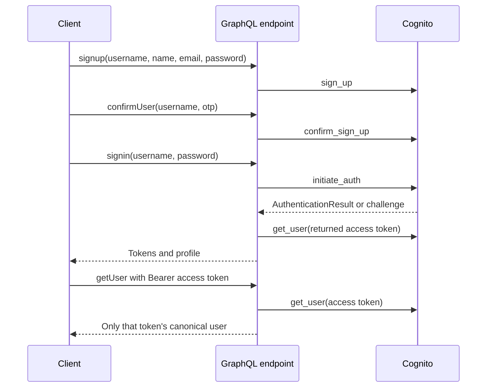

# Cognito account GraphQL prototype

A Django/Graphene account-flow exercise for a fitness application: sign up, confirm an email code, sign in, and fetch the signed-in user's profile through AWS Cognito. There are no workouts, health records or fitness analytics in the current models.

The original [Altercall fitness project context](https://github.com/dev-nezuko/wellness-account-api) is retained. This repository demonstrates an authentication integration boundary, not a complete wellness backend.

## Account flow



`getUser` no longer performs an anonymous administrative lookup. The provided username must match Cognito's returned canonical username; it cannot request another account. Provider exception text is replaced with a generic GraphQL error. MFA/new-password challenges return an explicit unsupported-flow error rather than pretending sign-in succeeded.

## Local configuration

The legacy requirements declare Django 3.x; source was generated with Django 4.2. The full declared environment has not been reproduced. Use an isolated environment and review that mismatch before deployment:

```sh
python3 -m venv .venv
source .venv/bin/activate
python -m pip install -r requirements.txt
cp .env.example .env
python manage.py migrate
python manage.py runserver 127.0.0.1:8000
```

The root `.env` is loaded explicitly. Set `COGNITO_REGION` and `COGNITO_CLIENT_ID` for a sandbox client supporting the implemented password/sign-up flows. Use your normal AWS credential chain where needed; never commit AWS keys. The legacy user-pool-ID setting is retained but the implemented profile operations no longer call admin APIs. Pool/client provisioning and IAM configuration are outside this repository.

For a local demo, `DEBUG=true` allows a process-local random Django signing key. Set a private `SECRET_KEY` for stable sessions or non-debug use. `ALLOWED_HOSTS` defaults to loopback/localhost; `CORS_ALLOWED_ORIGINS` is an explicit comma-separated allowlist. The development GraphiQL explorer at `/graphql` is enabled only in debug mode.

## GraphQL shape

A synthetic profile request:

```graphql
query {
  getUser(username: "synthetic-user") {
    id
    name
    username
    email
  }
}
```

Send `Authorization: Bearer <Cognito access token>`. Other supported fields are `signup`, `confirmUser` and `signin`; GraphiQL shows their arguments. Sign-in returns `accessToken`, `refreshToken`, `userId`, `userName` and `userEmail`. Tokens are returned to the caller but are not persisted in a bundled database. Use only synthetic sandbox accounts while evaluating the flow.

## Verification and limits

```sh
python -m unittest accounts.tests -v
```

Seven schema-level tests pass with mocked Cognito: required token, same-user profile, other-user rejection, sign-in profile lookup, challenge handling, generic provider errors, and sign-up/confirmation. They execute Graphene without the Django HTTP view or a database. All Python files parse. Verification used existing Django 4.2/Graphene 3/Boto3 dependencies; the HTTP stack, CORS/CSRF behavior, live Cognito delivery/login and full legacy environment remain unverified.

The Cognito client is lazy, so importing the schema does not create an SDK client or probe ambient credentials. Remaining work includes refresh/revoke/logout mutations, full challenge flows, rate limiting, client-secret support, browser session storage design and Django HTTP integration tests. The GraphQL view remains CSRF-exempt; assess the complete browser authentication design before hosting.

## Deployment workflow needs separate review

The existing workflow deploys via SSH on pushes to `main`, uses a mutable third-party action reference, and assumes a specific remote checkout. It has not been exercised or modernized here. This maintenance push uses `[skip ci]` to avoid triggering deployment, following [GitHub's documented push-workflow skip behavior](https://docs.github.com/en/actions/how-tos/manage-workflow-runs/skip-workflow-runs). Review and protect that workflow before a future deployment-enabled push; local tests do not establish deployment readiness.
