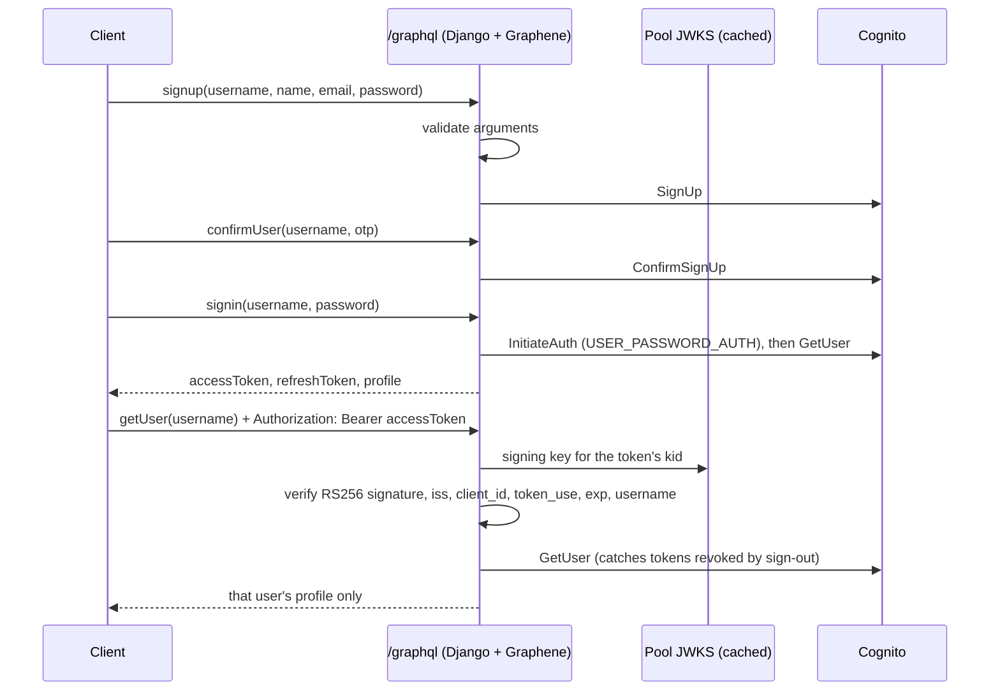

# Cognito account GraphQL API

A small Django/Graphene service that fronts AWS Cognito for a fitness app's account flow: sign up, confirm the emailed code, sign in, and read the signed-in user's own profile. It holds no data of its own; Cognito is the user store.

It started as the account piece of the Altercall fitness project. There are no workouts, health records or analytics here, only the authentication boundary, so it is useful as a reference for putting a GraphQL API in front of a Cognito user pool without trusting the client more than it should.

## How a request flows



## Design choices

- **Tokens are verified locally first.** `getUser` checks the access token against the user pool's JWKS with PyJWT: RS256 only, issuer `https://cognito-idp.<region>.amazonaws.com/<pool id>`, `client_id` equal to this app client, `token_use=access`, and a current `exp`. The `username` claim must match the requested username. Only then is Cognito's `GetUser` called, which also rejects tokens revoked by a global sign-out.
- **No account enumeration through error text.** A wrong password and an unknown user both return `Incorrect username or password`; a wrong code and an unknown user both return `The confirmation code is invalid or expired`. Other Cognito codes are logged server-side and answered generically, and Cognito's own messages never reach the client. Any non-GraphQL exception is logged and returned as `Internal server error`.
- **Arguments are validated before any Cognito call**: usernames 1-128 characters without spaces, a trimmed printable name, a valid email, a password within Cognito's 256-character cap, and a 6-digit confirmation code. The pool's password policy is still enforced by Cognito.
- **CSRF.** Authentication is a bearer header, not a cookie, so the view is CSRF-exempt only for `application/json` and `application/graphql` bodies, which a browser sends cross-site only after a CORS preflight. Form and `text/plain` posts get `415`, and mutations over GET get `405`. `CORS_ALLOWED_ORIGINS` is the preflight allowlist.
- **Query limits.** Operations deeper than `GRAPHQL_MAX_DEPTH` (default 5) are refused. Schema introspection (`__schema`, `__type`) follows `DEBUG` unless `GRAPHQL_INTROSPECTION` is set; `__typename` always works so Apollo/Relay clients are unaffected.
- **Stateless.** No database, admin site or sessions; nothing is persisted. The Cognito calls used (SignUp, ConfirmSignUp, InitiateAuth, GetUser) are public-client operations, so the service needs no AWS keys.

## Configuration

Copy `.env.example` to `.env`. The root `.env` is loaded explicitly.

| Variable | Purpose |
| --- | --- |
| `DEBUG` | `true` enables GraphiQL at `/graphql` and a per-process random signing key. Defaults to `false`. |
| `SECRET_KEY` | Required when `DEBUG` is false; the app refuses to start without it. |
| `ALLOWED_HOSTS` | Comma-separated host names. Defaults to `127.0.0.1,localhost`. |
| `CORS_ALLOWED_ORIGINS` | Comma-separated browser origins allowed to call `/graphql`, e.g. `http://localhost:3000`. Empty means none. |
| `COGNITO_REGION`, `COGNITO_USER_POOL_ID`, `COGNITO_CLIENT_ID` | The user pool and an app client with `USER_PASSWORD_AUTH` enabled and no client secret. Without all three, account operations return `Configure Cognito before using account operations`. |
| `GRAPHQL_MAX_DEPTH` | Maximum operation depth (default 5). |
| `GRAPHQL_INTROSPECTION` | `true`/`false`; defaults to the `DEBUG` value. |

Creating the pool and app client is outside this repository. Use a sandbox pool and synthetic accounts while evaluating.

## Running it

Python 3.12 (see `.python-version`):

```sh
python3.12 -m venv .venv
. .venv/bin/activate
pip install -r requirements-dev.txt
cp .env.example .env        # then fill in the Cognito values
python manage.py test --settings=fitness_tracker.test_settings
python manage.py runserver 127.0.0.1:8000
```

With `DEBUG=true`, open http://127.0.0.1:8000/graphql for GraphiQL.

As a container (gunicorn, non-root user `app`, works with `--read-only`):

```sh
docker build -t wellness-account-api .
docker run --rm -p 8000:8000 --env-file .env \
  -e DEBUG=false -e SECRET_KEY="$(python3 -c 'import secrets; print(secrets.token_urlsafe(50))')" \
  wellness-account-api
```

The image is meant for production mode, so GraphiQL (a `DEBUG` feature) is not served there; use `runserver` for it.

## Tests

`python manage.py test --settings=fitness_tracker.test_settings` runs 48 tests offline. Cognito is replaced by botocore's `Stubber`, which also checks every request against the Cognito API model, and access tokens are signed with an RSA key generated per run and served from a stubbed JWKS. Nothing reaches AWS. The suite covers token verification (wrong key, unknown `kid`, HS256 and unsigned tokens, other issuer, other app client, ID tokens, expiry, missing claims, revocation), error mapping, argument validation, depth and introspection limits, the CSRF guard and the CORS preflight. `ruff check .` lints the project.

## Example requests

POST JSON to `/graphql`. The responses below were captured from the real view with Cognito stubbed (demo user, locally signed token), so they show exactly what the API returns.

```sh
curl -s http://127.0.0.1:8000/graphql -H 'Content-Type: application/json' \
  -d '{"query": "mutation { signup(username: \"riley\", name: \"Riley Park\", email: \"riley@example.com\", password: \"correct-horse-battery\") { user { username name email } } }"}'
```

```json
{"data": {"signup": {"user": {"username": "riley", "name": "Riley Park", "email": "riley@example.com"}}}}
```

Confirm with the emailed code:

```graphql
mutation { confirmUser(username: "riley", otp: "482913") { success } }
```

```json
{"data": {"confirmUser": {"success": true}}}
```

Sign in (Cognito's real tokens are JWTs; the stub returned short placeholders):

```graphql
mutation {
  signin(username: "riley", password: "correct-horse-battery") {
    accessToken refreshToken userId userName userEmail
  }
}
```

```json
{"data": {"signin": {"accessToken": "stub-access-token", "refreshToken": "stub-refresh-token", "userId": "7f3c-demo", "userName": "riley", "userEmail": "riley@example.com"}}}
```

Read your own profile with `Authorization: Bearer <accessToken>`:

```graphql
query { getUser(username: "riley") { id name username email } }
```

```json
{"data": {"getUser": {"id": "7f3c-demo", "name": "Riley Park", "username": "riley", "email": "riley@example.com"}}}
```

Asking for someone else with the same token, or sending a token that fails verification:

```json
{"errors": [{"message": "Only your own canonical username can be requested", "locations": [{"line": 1, "column": 9}], "path": ["getUser"]}], "data": {"getUser": null}}
{"errors": [{"message": "The access token is invalid or expired", "locations": [{"line": 1, "column": 9}], "path": ["getUser"]}], "data": {"getUser": null}}
```

A wrong password, and a malformed confirmation code (rejected before Cognito is called):

```json
{"errors": [{"message": "Incorrect username or password", "locations": [{"line": 1, "column": 12}], "path": ["signin"]}], "data": {"signin": null}}
{"errors": [{"message": "Invalid otp: enter the 6-digit code from the confirmation email", "locations": [{"line": 1, "column": 12}], "path": ["confirmUser"], "extensions": {"field": "otp"}}], "data": {"confirmUser": null}}
```

A form-encoded POST gets `415 {"errors": [{"message": "Send GraphQL requests as application/json"}]}`, and with introspection off `{ __schema { types { name } } }` gets `400` with `Cannot query '__schema': introspection is disabled.`

## Limits

- Only the plain password flow is implemented. MFA and new-password challenges return `Additional authentication challenge is not implemented`; refresh, sign-out and password reset mutations do not exist yet.
- App clients with a client secret are not supported (no `SECRET_HASH`).
- There is no rate limiting beyond what Cognito applies.
- The live Cognito round trip has not been exercised in this repository; all verification uses stubs.

## License

MIT, see [LICENSE](LICENSE).
